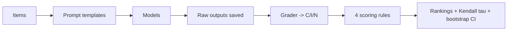

# Prompts 04-07: feasibility, RQs, plan, frozen-protocol DRAFT (not frozen until you confirm UNKNOWNs)
## 2. Novelty search strings (run them yourself; no titles claimed here)
- "scoring rule" OR "abstention" AND "LLM benchmark" AND ("ranking" OR "rank correlation")
- "calibration" "verbalized confidence" benchmark science LLM
- "selective prediction" OR "risk-coverage" question answering LLM
- "multiple-choice" "open-ended" gap LLM knowledge evaluation
- "benchmark ranking stability" OR "leaderboard sensitivity" LLM
Inspect: abstention/selective-QA work, calibration surveys, leaderboard-robustness work, SimpleQA follow-ups. Fill matrix: method | VERIFIED contribution+source | limitation | my difference | missing evidence.
## 3. Research problem
Scientific-factuality benchmarks score confident guessing and abstention inconsistently (review §8). Whether this changes conclusions is untested *in this review*; whether it is untested in the literature is UNKNOWN.
- RQ1 (primary): Do model rankings on the same science QA items change under accuracy, attempted-precision, SimpleQA-style F, and error-penalised score (lambda=1)? 
  Decision rule (set now, before data): rankings "unstable" if bootstrap 95% CI of Kendall tau(accuracy, penalised) lies wholly below 0.8. Contradicting observation: CI lower bound >= 0.8 for all rule pairs.
  Caveat: with 3 models tau takes only 4 values; use >=6 models.
- RQ2 (secondary): Calibration (ECE of verbalised confidence) vs accuracy rank.
- RQ3 (optional): MCQ-vs-open-answer gap (G2).
## 4. Datasets/comparators (all access UNKNOWN until you verify at official sources)
Candidates: SciFact (claim verification), a MedQA/PubMedQA subset, GPQA (gated; license/canary rules), SimpleQA (if accessible). Baseline = plain accuracy ranking. Leakage: same-question duplicates across datasets; prompt-order effects; fix option order + seeds.
## 5. Frozen protocol checklist (tick before viewing any result)
[ ] models + versions listed  [ ] prompt templates saved incl. abstention wording  [ ] item subset + seed fixed  [ ] decoding temp=0, max tokens fixed  [ ] grader fixed (exact match / MCQ letter; LLM judge only if validated on 100 hand-labelled items)  [ ] metrics + decision rule above fixed  [ ] bootstrap B=1000, seed fixed
Protocol changes after viewing results go in research_decisions.md as dated amendments with reason; the original rule stays reported.
Analyses: bootstrap CIs, abstention-rate vs rank, per-dataset breakdown. Threats: prompt sensitivity, abstention elicited by prompt not model, grader error, few models.

